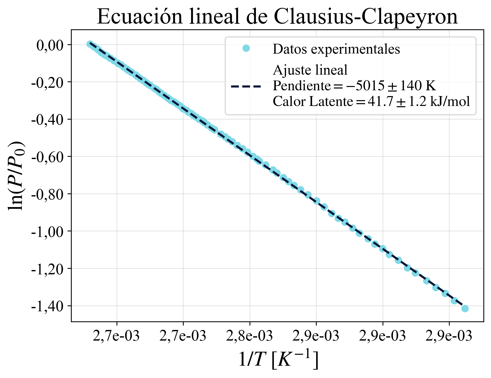

# Clausius-Clapeyron Equation

## Overview

This project presents the experimental analysis of the vapor-liquid equilibrium using the Clausius-Clapeyron equation.

The objective is to study the relationship between temperature and pressure and estimate the latent heat of vaporization from experimental data.

## Methodology

The analysis includes:

- Loading and processing experimental data using Python.
- Linearization of the Clausius-Clapeyron equation.
- Linear regression and parameter estimation.
- Uncertainty analysis.
- Graphical representation of the experimental results.

## Technologies

- Python
- NumPy
- Matplotlib

## Project Structure

```text
clausius-clapeyron/
├── clausius-clapeyron.py
├── data/
│   └── datos_experimentales.csv
├── results/
│   └── grafico_clausius_clapeyron.png
├── README.md
└── requirements.txt
```

## Results

The experimental data were analyzed through a linearized representation of the Clausius-Clapeyron equation to estimate the latent heat of vaporization.



## How to run

1. Clone this repository.
2. Install the required libraries:

```bash
pip install -r requirements.txt
```

3. Run the Python script:

python clausius-clapeyron.py

## Author

**Juliana Mastrangelo**

Physics undergraduate student at the National University of Rosario (UNR), Argentina.